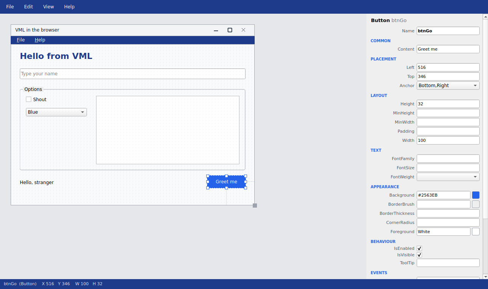
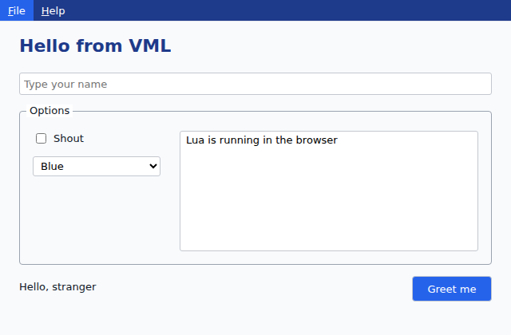

# Visualised

*Apps are written in VML, Visualised's own markup.*

**A cross-platform RAD IDE that designs itself, for the desktop and the web**

VML is a lightweight, patent-pending application development system: simple flat markup, scripted in Lua or the
operating system's own shell, running as real native desktop applications on Linux, Windows and macOS. Think Visual
Basic 5, rebuilt for 2026: draw a form, double-click a button, write what it does, press F5.

The designer is itself a VML form. So is its script editor. VML builds VML.



## What makes VML unique

### The Parent= innovation

Unlike nested UI markup (XML, XAML, HTML), VML uses a **flat structure with named parent references**:

```vml
@Window MainWindow
Title=My Application
Width=800
Height=600

@StackPanel Container
Parent=MainWindow
Margin=20

@Button SaveBtn
Parent=Container
Content=Save
OnClick=SaveScript

@Script SaveScript
Interpreter=lua
<<LUA
Vml("InfoDialog", "Saved!")
LUA
```

- No closing tags, no nesting hell
- grep, sed and awk friendly
- Refactor by changing one `Parent=` line
- Human readable, machine parseable

### Architecture

```
VML file (.vml)
    ↓
Lua parser (vml-parser.lua, ~300 lines)
    ↓
SQLite (controls, properties, scripts)
    ↓
Control registry → Qt widgets (PySide6)
    ↓
Scripts: Lua (embedded) · Bash · PowerShell
```

Every script talks to the running application through one function:

```lua
local name = Vml("GetProperty", "txtName", "Text")
Vml("SetProperty", "lblHello", "Text", "Hello, " .. name)
```

The **control registry** is the single source of truth: each control type is declared once, with every property
(its kind, editor, group, how to set it and read it back) and its events. Rendering, the `Vml()` API and the
designer's property panel are all driven from it, so a property added once appears everywhere.

## Download

- **Windows:** [Visualised-Setup.exe](https://github.com/wallisoft/vml-releases/releases/latest/download/Visualised-Setup.exe) (no admin needed), or the [portable zip](https://github.com/wallisoft/vml-releases/releases/latest/download/vml-windows-x64.zip)
- **Linux:** `curl -fsSL https://github.com/wallisoft/vml-releases/releases/latest/download/install.sh | bash`
- More at **[vml.eur.bz](https://vml.eur.bz)**, including a live demo in your browser.

## Quick start (from source)

Requires Python 3.10+.

```bash
pip install -r requirements.txt
./vml.py                       # the designer
./vml.py path/to/any-form.vml  # run any VML form
```

## The designer

- **Right-click the form to add a control.** The list comes from the registry, so new control types appear automatically.
- **Drag to move, drag the handles to resize.** Snaps to the grid; hold Alt for free movement. Arrow keys nudge
  (Shift for a grid step).
- **Anchors:** pin a control to the form's edges so it moves or stretches as the window resizes (an OK button in
  the corner, a text box that spans the width, a list that fills the form). Drag the form's corner to see it live.
- **Frames:** right-click inside a Frame to add a control to it, or drag a control onto a frame (and off it
  again). Frames carry their contents with them; anchor the frame and its contents to make whole areas stretch.
- **Live position and size** on the status bar while you drag, resize or nudge.
- **Form options:** title, size, background, resizable, modal, minimum and maximum size, shown on a window title
  bar above the form as you design.
- **Menus, two ways.** Right-click the form and choose **Add Menu** for File, Edit and Help (Exit and About already
  work), then treat menu items like controls: click a
  caption to select it and edit it in the property grid, and right-click any item for Add Before, Add After, Add
  Submenu Item, Delete and Edit Script. Or use the **Menu Editor** (Ctrl+M), after VB5's: type a caption, press
  Next, indent with the arrows. Either way, the form shows its real menu bar as you design. Click the bar's empty
  space for its own properties: colours, and opening dropdowns on hover.
- **Bring to Front / Send to Back, Duplicate (Ctrl+D), Delete.**
- **The property grid** edits whatever is selected: grouped, with checkboxes, dropdowns and colour pickers, and
  live, so it never goes stale. Click the empty form to edit the form itself.
- **Double-click a control to script it.** Choose the event and the language (Lua, or the OS shell), and write.
  Scripts are saved into the form as ordinary `@Script` blocks.
- **Export** (File → Export): a **Windows app** or **Linux app** (the compiled runtime renamed after your app,
  beside your forms: unzip and double-click), or a **web page** with the Lua engine inside it, so it works offline.
- **F5 previews** the form running for real. **Ctrl+S** saves plain VML; **Ctrl+O** opens it again.
- **Projects** (the Project menu): several forms and modules as one app, with a project tree above the properties.
  F5 then runs the whole app from its start-up form. See [Projects](#projects).
- **Import** (File → Import, Pro): forms and whole projects from Visual Basic 5/6 (`.frm`, `.vbp`) and from Visual
  Studio Windows Forms (`.vbproj`, `.csproj`, VB.NET or C#). Controls, layout, menus and pictures come across; each
  event handler's original code is kept as comments on its control, and the rest of the code as modules of
  comments, to rewrite. It does not run, with one exception: the plain steps of Visual Basic that can only mean one
  thing (`frmAbout.Show`, `Unload Me`, `End`, a `MsgBox` whose words are written out, `x.Enabled = False`,
  `x.Caption = "…"`) are turned into Lua, so an imported app opens and closes its own forms from the start. Nothing
  inside an `If` or a loop is turned, nor anything after a line that might have left the routine early; each turned
  line keeps its original beside it. C# is kept whole as comments.
- **Data comes too.** SQLite files in the project's folder are copied and named in the project. Access files (`.mdb`,
  `.accdb`) there, or named in the code, have their tables and rows copied into a SQLite file the app carries with it
  (to the web as well) where the computer has an ODBC driver for Access (it comes with Access, or free as Microsoft's
  Access Database Engine; on Linux, `sudo apt install odbc-mdbtools`). Grids and lists that were bound to a Visual
  Basic data control are given an `ItemsSource` asking for the same rows. Importers are not built in: see
  [Importers](#importers).

## On the web

The same `.vml` file runs in a browser. **View → Preview in Browser** (F6) in the designer, **File → Export to
HTML…**, or from a terminal:

```bash
./vml.py html myform.vml          # writes myform.html: one self-contained page, works offline
./vml.py html myform.vml --open   # ...and opens it in your browser via a tiny local web server
```

Layout is faithful: canvas forms are positioned exactly, and **anchors become CSS**, so controls move and stretch as
the browser window resizes. Frames, menus, StackPanel, Grid, Border and DockPanel all carry across. **Lua scripts run
unchanged** in the browser (Lua 5.4 compiled to WebAssembly, bundled into the page, so no network is needed), against a JavaScript `Vml()` that speaks the same
commands, `require("dkjson")` included, databases too (see [Data](#data)). Shell, C# and Python scripts are desktop-only and say so in the browser
console. Open the console and `vml.Vml("GetProperty", "txtName", "Text")` works there too.



## Scripting

| Language | How it runs |
|---|---|
| **Lua** | Embedded (Lua 5.4 via `lupa`), in-process and fast. One state per form, or shared by named instance. `require("dkjson")` available. |
| **Bash** | As a subprocess, with the `vml` command on its `PATH` to talk to the form (and `$VML_DB_PATH`, `vml-parse` as before). |
| **PowerShell** | As a subprocess, on Windows (or anywhere `pwsh` is installed). |
| **Python** | As a subprocess, using your own Python and its packages, with a native `Vml()` function (`from vml.client import call`) and `args`. |
| **C#** (optional) | Compiled with Roslyn by a small .NET host that stays running; cached, so repeat runs are instant. |

Events include clicks, text changes, selection, pointer, focus and keys (`OnKeyDown` and `OnKeyUp` receive
the key, its text and the Ctrl/Shift/Alt modifiers). Event handlers can name a script (`OnClick=SaveScript`), pass it arguments (`OnClick=AddItem(Button)`), call an
engine command (`OnClick=FormOpenModal about.vml`), or be a line of Lua.

**Each form has its own Lua state**, so its globals are its own. To share state deliberately, give scripts the same
**named instance**: `Interpreter=lua mygame` (or `Instance=mygame`). Every script in that instance, in any form, sees
the same globals.

### Bash, PowerShell, and any other language: the `vml` command

Scripts VML runs have a `vml` command on their PATH that talks to the running form:

```bash
name=$(vml get txtName Text)
vml set lblHello Text "Hello, $name"
vml setting last_user "$name"
vml run SaveScript "$name"        # any script, in any language; prints what it returns
vml InfoDialog "Saved!"           # or any Vml() command by name
```

```powershell
$name = vml get txtName Text
vml set lblHello Text "Hello, $name"
```

Plain control names mean the script's own form (`Form.Control` reaches another). A failed call prints an error and
exits with 1, so `||`, `$?` and `$LASTEXITCODE` work. Programs VML didn't start can drive a running form too:
`./vml.py get txtName Text` from a terminal, or any language speaking one line of JSON over the local socket
described in `~/.vml/api.json` (readable only by you; the token in it is required).

### C# (optional)

C# scripts need Microsoft's free .NET SDK (8.0 or later). **Settings → C# Scripting** in the designer checks for
it, helps you get it if it's missing, and builds the C# host (into `~/.vml/csharp`, so it works for an installed
copy too). From a terminal, `./vml.py setup-csharp` does the same build.

C# then appears in the script editor alongside Lua and the shell, with the same API:

```csharp
var name = Vml("GetProperty", "txtName", "Text");
State["clicks"] = (State.TryGetValue("clicks", out var c) ? (int)c : 0) + 1;   // State: kept per form
Vml("SetProperty", "lblHello", "Text", $"Hello, {name} ({State["clicks"]})");
```

Script arguments are in `args`, `Console.WriteLine` goes to the log, and C# and Lua can call each other through
`RunScript`. The first run of a script takes about a second to compile; after that it's instant. Without .NET,
nothing changes: C# simply isn't offered.

### Multiple forms

```lua
-- open a form (paths are relative to this one); if it's already open it comes to the front
Vml("FormOpen", "settings.vml")

-- open one and wait for it to close; it hands back whatever it passed to SetDialogResult
local answer = Vml("FormOpenModal", "confirm.vml")

-- in the child: read and write the parent's controls by Form.Control
local name = Vml("GetProperty", "Main.txtName", "Text")
Vml("SetProperty", "Main.lblStatus", "Text", "Saved")
Vml("SetDialogResult", "ok")
Vml("CloseSelf")
```

Plain control names always mean "my own form", so two forms can both have a `btnOK`. `ShowForm`, `HideForm` and
`CloseForm` manage open forms by name. Previewing a saved form in the designer finds its child forms next to the file.

### Timer, ProgressBar, Splitter

```vml
@Timer tmrClock            -- not seen when the form runs; a small clock on the design surface
Interval=1000              -- milliseconds
IsEnabled=true             -- false stops it; a script can turn it on and off
OnTick=ShowTime

@ProgressBar barCopy
Value=40                   -- between Minimum (0) and Maximum (100)
BarStyle=Blocks            -- Solid, Blocks or Thin
ShowText=true              -- the percentage, written on the bar
IsIndeterminate=false      -- true sweeps to and fro, for work of unknown length
Foreground=#16A34A         -- the bar; Background is the track behind it

@Splitter split            -- in a DockPanel: drag it to resize the pane docked just before it
DockPanel.Dock=Left
```

All three work the same in a web page. A form's `OnClosing` runs when its window closes; `Vml("CancelClose")` in it
keeps the form open, and `Vml("ChoiceDialog", "Save the changes?", "Unsaved", "Save|Don't Save|Cancel")` asks a
question with answers of your own.

### Importers

An importer is not part of the engine. It is a VML file of Lua scripts in `designer/importers` (the ones that come
with Visualised) or `~/.vml/importers` (your own, and other people's). File → Import lists whatever is there, and
**Add an importer…** at the foot of that menu copies one in.

```vml
@Importer VB6
Title=Visual Basic 5/6 form
Files=frm
ProjectTitle=Visual Basic 5/6 project
ProjectFiles=vbp

@Script Library         -- optional: run once, for functions the other two share
@Script ImportForm      -- args[1] the file, args[2] a folder for its pictures or ""; returns JSON {vml, notes} or {error}
@Script ImportProject   -- args[1] the project file, args[2] the new folder; returns JSON {project, summary, ...}
@Script ExportForm      -- the way back (reserved: nothing in 1.0 calls it yet): args[1] a .vml, args[2] the file to write
@Script ExportProject   -- likewise for a whole project: args[1] a .vmlproj, args[2] the new folder
```

`local kit = require("importkit")` gives an importer what it needs: regular expressions, reading and writing files
(text and binary), a builder for the VML form, and one for a whole project (`designer/importers/lib/importkit.lua`).
It also holds what importers share, so each is written once: `kit.basic_steps` (the plain steps of Basic, made to
run) and `project:access_databases` (Access data into SQLite).
To change how something comes across, copy the importer, give the copy a name of its own on its `@Importer` line,
and add it: the built-in importers keep their names (as do Delphi, Qt, XAML and HTML, which are on their way). `vb6.vml` and `winforms.vml` are the two to read before writing your own.

### Projects

A project is one small text file, `MyApp.vmlproj`, in the folder that holds the app (after VB's `.vbp`):

```
# Visualised project
Name=MyApp
Startup=frmMain.vml
Form=frmMain.vml
Form=frmLogin.vml
Module=helpers.lua
Database=main=sqlite:data.db
```

- **Forms** open each other by name: `Vml("FormOpen", "frmLogin")`.
- **Modules** are Lua files whose functions every form's scripts can call, with no `require`.
- **A handler can be a function in a module.** `OnClick=SaveOrder` runs the form's script of that name, or, if it
  has none, the function `SaveOrder` in one of the project's modules, in the form that asked (so
  `Vml("GetProperty", "txtName", "Text")` reads that form's box). `OnClick=Greet(Ann, Bob)` passes arguments,
  `Vml("RunScript", "SaveOrder")` runs one from a script, and `ItemsSource=Names` fills a list from one. A form
  can then be all layout, with its code in the project's modules. It works the same on the web.
- **The designer is a project.** `designer/Designer.vmlproj` is its five forms and the modules that hold what its
  menus do (`designer/modules/*.lua`). Open it in the designer to read or change it. It keeps its own modules and
  its own `Project` table while it runs yours.
- Each form keeps its own Lua state. For a value the whole app shares, use the **`Project` table**:
  `Project.user = "steve"` in one form is `Project.user` in all of them.
- **Databases** named here open by themselves when first used (see below).
- `./vml.py MyApp.vmlproj` runs the app; a form opened on its own finds its project; and **Export** packages the
  whole project (forms, modules, pictures, local databases) as one app.

### Data

**Project → Browse Data…** looks inside any database the project names, SQLite or ODBC: its tables, the first rows of
each, and a SELECT of your own. It only reads. **Settings → Databases (ODBC)…** shows the project's databases, the ODBC drivers and data sources this computer has,
builds an address from boxes (driver or DSN, server, database, user), tests it, and can copy an ODBC database's
tables and rows into a SQLite file the app carries with it. A password need not be kept in the project file:

```
Database=sales=odbc:Driver={ODBC Driver 18 for SQL Server};Server=db1;Database=Sales;UID=reports;PWD=?
Database=stock=odbc:DSN=Stock;UID=${STOCK_USER};PWD=${STOCK_PASSWORD}
Database=hr=odbc:Driver={ODBC Driver 18 for SQL Server};Server=db1;Database=HR;Trusted_Connection=Yes
```

`PWD=?` asks for the password the first time the app connects (it is not saved), `${NAME}` reads an environment
variable, and `Trusted_Connection=Yes` is Windows sign-in. Passwords are never written to the log.

```lua
Vml("DbOpen", "main", "sqlite:data.db")                -- a SQLite file beside the form
Vml("DbOpen", "sales", "odbc:DSN=Sales;UID=me;PWD=x")  -- anything with an ODBC driver: SQL Server, MySQL, Access...
local rows = Vml("DbQuery", "main", "SELECT name FROM people WHERE age > ?", 30)   -- JSON, one object per row
Vml("DbExecute", "main", "UPDATE people SET age = ? WHERE id = ?", 31, 7)
```

A ListBox, ComboBox, DataGrid or TreeView with **`ItemsSource`** fills itself, and fills itself again whenever a
control it names changes, with no event scripts:

```vml
@ComboBox cboCategory
ItemsSource=SELECT DISTINCT category FROM questions ORDER BY 1

@ListBox lstQuestion
ItemsSource=SELECT question FROM questions WHERE category = {cboCategory}
```

`{cboCategory}` is that control's current choice (`{txtName}` a text box's text, `{chkAll}` true or false,
`{grid.SelectedItem}` any property). Values go to the database as parameters, never pasted into the SQL.
`Database=` names which database to ask (default: the project's first, or the form's own). `ItemsSource` can also
name a script, `ItemsSource=LoadQuestions(cboCategory)`, which returns a JSON array or one item per line.
`Vml("Requery")` fills them again after the data changes. ODBC needs the driver for your database installed
(and, on Linux, unixODBC: `sudo apt install unixodbc`).

**On the web too.** A page exported from a form that uses a database carries SQLite inside it (compiled to
WebAssembly, about 0.9 MB, and only for pages that need it), along with the project's SQLite files. `ItemsSource`,
cascades, `DbQuery` and `DbExecute` work in the browser as on the desktop. Changes made in the browser are kept in
that browser and shared by the app's other pages; they don't go back into the file. ODBC is desktop-only.

`apps/datablocks` is a small worked example: content kept as tagged "data blocks", lists that narrow each other,
and a form to maintain them. It is two forms and one Lua module, with nothing added to the engine.

Commonly used `Vml()` commands:

| | |
|---|---|
| Properties | `SetProperty` · `GetProperty` · `GetControlPropertiesJson` |
| Controls | `CreateControl` · `DeleteControl` · `ControlExists` · `GetChildControls` · `ClearChildren` |
| Shared state | `GetSetting` · `SetSetting` |
| Scripts | `RunScript` · `ExecuteScript` · `Shell` |
| Data | `DbOpen` · `DbQuery` (JSON) · `DbExecute` · `DbClose` · `DbTables` · `DbCopyTable` · `DbShow` · `DbDrivers` · `DbSources` · `DbTest` · `DbError` · `Requery` · `GridSetData` · `SqlQuery` · `SqlExecute` (the form's own database) |
| Files | `FileExists` · `FileRead` · `FileWrite` · `FileList` · `FileCopy` · `FileSize` · `FileReadBase64` · `FileWriteBase64` · `FolderDialog` |
| Text | `RegexMatch` · `RegexFindAll` · `RegexReplace` |
| Forms and dialogs | `FormOpen` · `FormOpenModal` · `SetDialogResult` · `ShowForm` · `HideForm` · `CloseForm` · `CloseSelf` · `InfoDialog` · `ConfirmDialog` · `FileOpenDialog` · `FileSaveDialog` |
| Menus | `ShowContextMenu` · `SetMenuItemEnabled` · `SetMenuItemText` |

## Controls

Window, Frame, StackPanel, Grid, DockPanel, Canvas, Border, ScrollViewer, TextBlock, TextBox (also a password box:
`IsPassword`), Button, CheckBox, RadioButton (grouped by container and `GroupName`), ComboBox, ListBox, DataGrid
(rows and columns, read-only), TreeView (`Items` are paths: `Forms/Main,Forms/Login`), Image (`Source` a file beside
the form, or a `data:` address), Rectangle, menus (TinyMenu, MenuItem, ContextMenu, MenuTheme), and **composite controls** defined in VML
itself with `@ControlTemplate` and `@PropertyMap`. Layout follows Avalonia's rules (DockPanel docking order, Grid
star sizing, Margin outside and Padding inside), so existing forms look the same.

The designer's own building blocks, `DesignSurface` and `PropertyGrid`, are ordinary registered controls, available
to any VML application.

## Project layout

```
vml/            the engine
  registry.py   every control type, property and event
  engine.py     rendering, the Vml() API, the script host
  design.py     DesignSurface and PropertyGrid
  store.py      SQLite, and the Lua parser runner
  data.py       databases (SQLite, ODBC) and ItemsSource
  projects.py   projects: forms, modules and databases as one app
  dialogs.py    the message, question and input boxes
  library.py    the importer library, and the file and pattern commands importers are written with
  lua/          vml-parser.lua, dkjson.lua
designer/       the designer, script editor, menu editor and module editor (VML + Lua)
  importers/    the importers: Visual Basic 5/6 and Windows Forms, each one VML file of Lua
tests/          tests that drive forms like a user does
packaging/      icon, installers (Windows, Linux) and the Store manifest
.github/        the release workflow: tag a version, get every download
```

## Tests

```bash
python3 tests/run_step1.py      # events, Lua, settings, shell, reflection
python3 tests/run_designer.py   # the designer: add, drag, resize, edit, script, save, reopen, preview
python3 tests/run_anchors.py    # anchors, in the designer and at runtime
python3 tests/run_frames.py     # frames, nesting, keys, live geometry, window options
python3 tests/run_menus.py      # menus: editor, menu bar and items as controls, saved, reopened and run
python3 tests/run_multiform.py  # forms opening forms, Form.Control names, dialog results, Lua states
python3 tests/run_csharp.py     # C# scripting (skips itself if .NET isn't set up)
python3 tests/run_controls.py   # option buttons, password box, pictures, grid, tree, the window edge, dialogs
python3 tests/run_data.py       # databases (SQLite, and ODBC if a driver is installed) and ItemsSource
python3 tests/run_projects.py   # projects: modules, the Project table, the designer's panel, export, importing from Visual Studio
python3 tests/run_web_controls.py  # the 1.0 controls and a project's modules, as a web page in a real browser
python3 tests/run_web_data.py   # databases inside a web page: ItemsSource, cascades and the Db commands, in a real browser
python3 tests/run_datablocks.py # the data blocks sample project, on the desktop and as web pages
python3 tests/run_library.py    # the importer library, an importer of your own, and the file and pattern commands
python3 tests/run_import_winforms.py  # the Windows Forms importer
python3 tests/run_import_vb6.py # the Visual Basic 5/6 importer
python3 tests/run_api.py        # the vml command and Python: calling back, chains across languages, outside programs
python3 tests/run_web.py        # the HTML renderer in a real browser (needs: pip install playwright)
python3 tests/run_formscripts.py # the form's own scripts (OnOpened, helpers) survive open, save and preview
python3 tests/run_process.py    # long-running jobs: live output, exit scripts, cancel
```

`tests/run_step2.py` exercises the original Avalonia-era designer from `~/.vml/designer`, if present.

## Roadmap

- Designing layout-based forms
- Undo and redo
- Mobile, via a renderer for phones
- The Microsoft Store listing
- Exporting your app as a Windows or Linux program

## History

VML began as Visual Bash Designer, a YAML-driven form builder, and grew into a .NET/Avalonia engine. In October 2026
it was rebuilt on Python and Qt, keeping the parser and the SQLite model. The Avalonia version is preserved in this
repository's history at the tag `avalonia-final`.

## Licence

Visualised is free software.

- **Visualised itself** is under the GNU General Public License, version 3: [LICENSE](LICENSE).
- **The apps you make with it are yours.** An exported app carries part of Visualised inside it, and
  [LICENSE-EXCEPTION.md](LICENSE-EXCEPTION.md) says that this places no condition on your app.
- **The Link relay and the site pages** in `server/` are under the GNU Affero General Public License, version 3:
  [server/LICENSE](server/LICENSE).
- **The example apps** in `apps/` are under the MIT licence, to copy from freely: [apps/LICENSE](apps/LICENSE).
- **The name** "Visualised" and its logo are trade marks: [TRADEMARKS.md](TRADEMARKS.md).
- For anyone who can't use GPL code there is a [commercial licence](LICENSE-COMMERCIAL.md).

Other people's work that Visualised includes is listed, with its licences, in
[packaging/THIRD-PARTY-NOTICES.txt](packaging/THIRD-PARTY-NOTICES.txt).

Built by Wallisoft with Claude.
